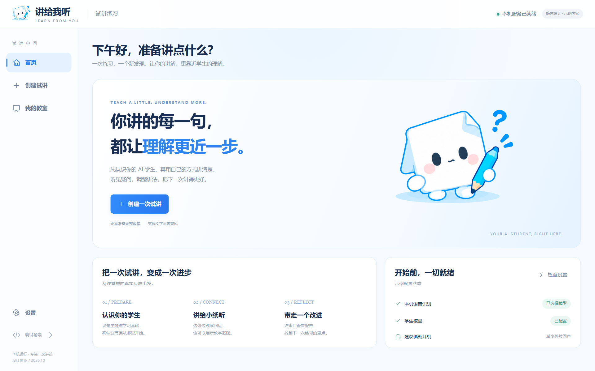
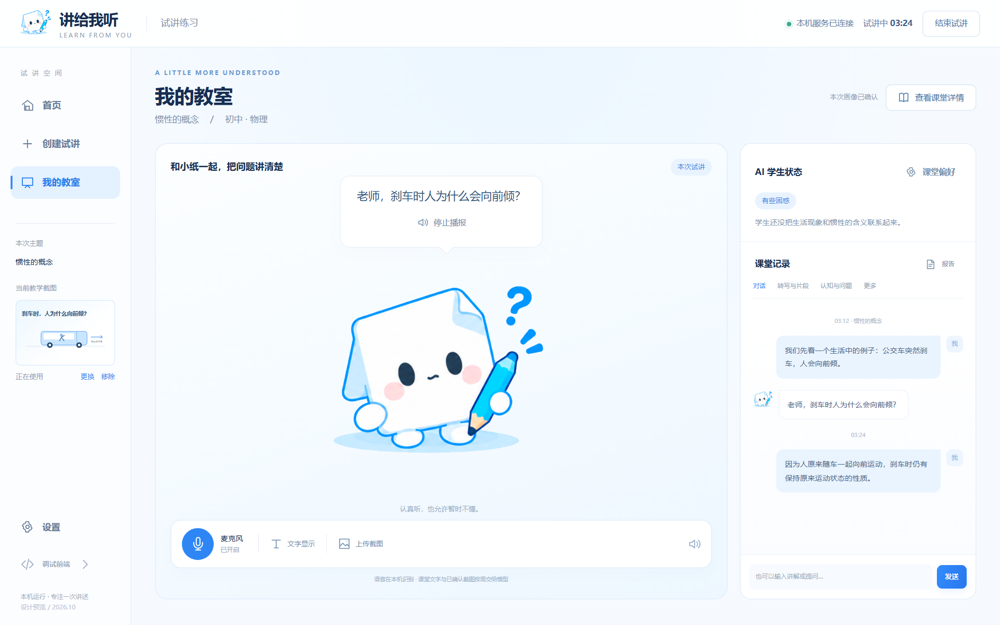
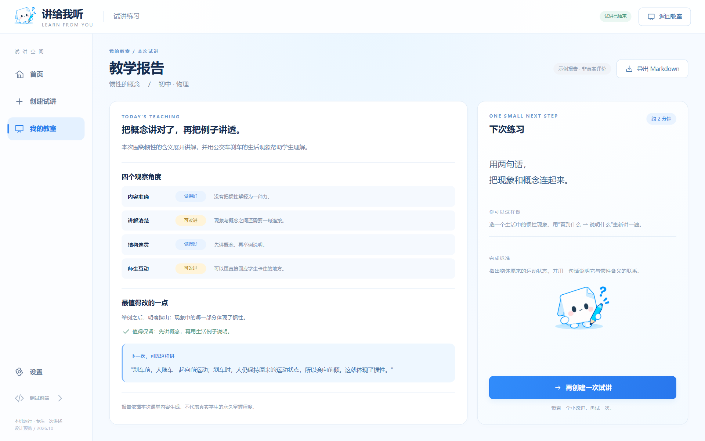
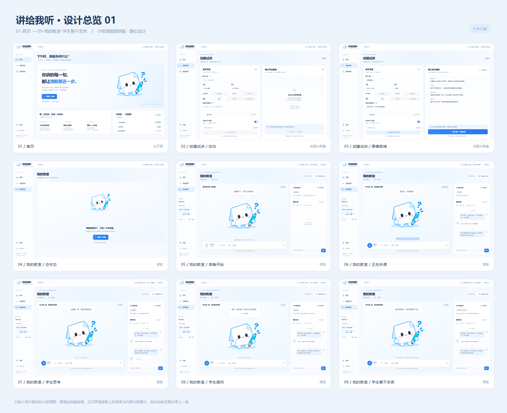
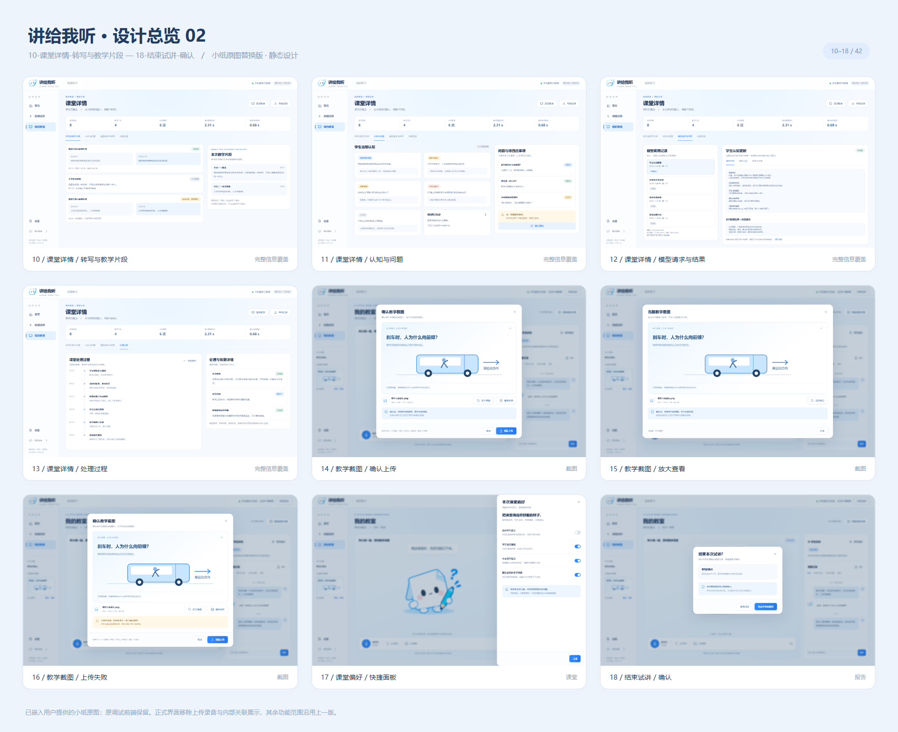
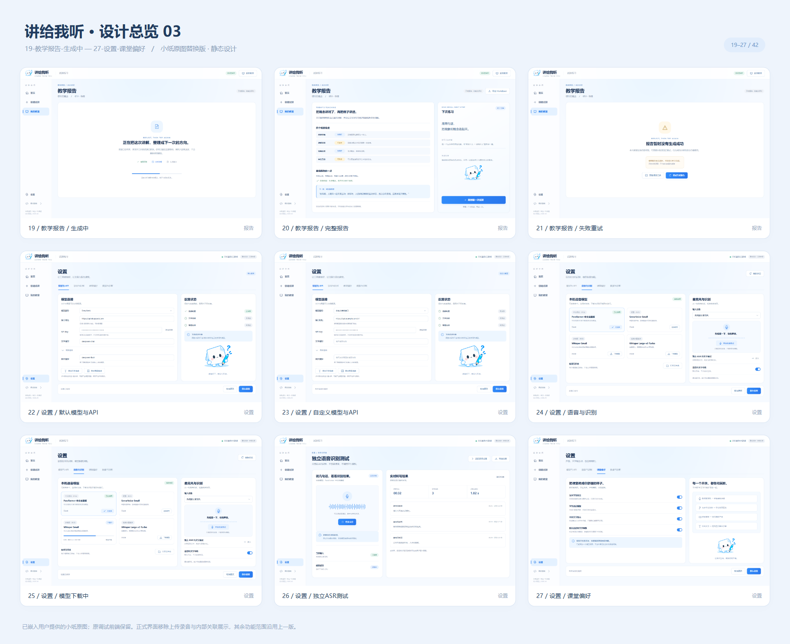
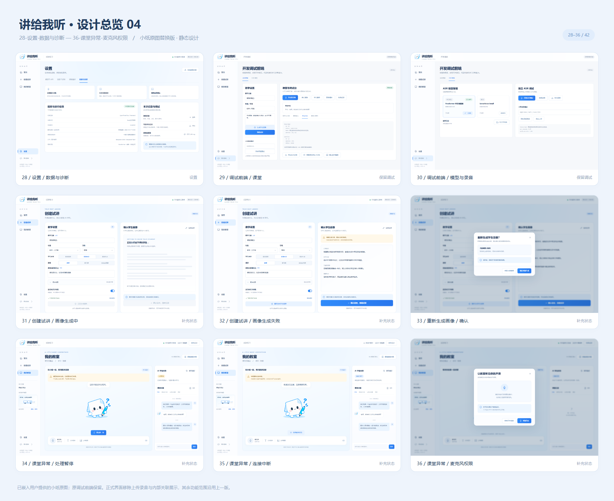
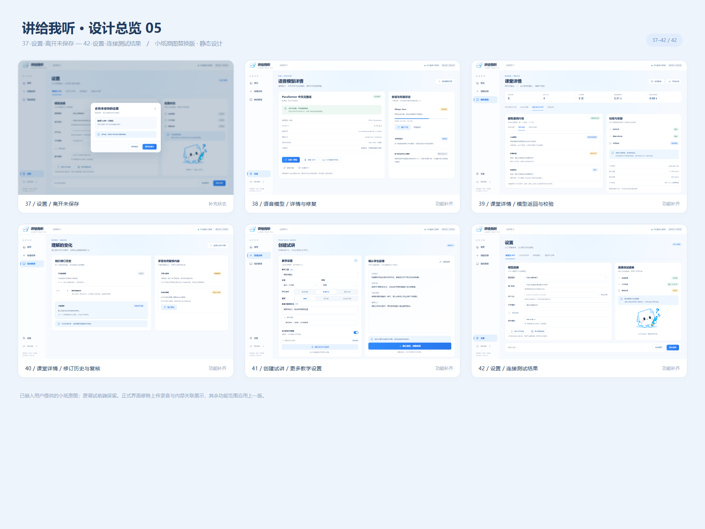

# 讲给我听 · 正式前端设计评审

默认查看 **V2 小纸原图版**。共42张1920×1200桌面页面与关键状态，另附5张总览。这里是静态设计交付，**正式前端尚未实现**。

[给队友的交接与功能覆盖](HANDOFF.md) · [V2详细说明](v2-xiaozhi/README.md) · [全部单页目录](#全部页面) · [第一版历史设计](v1-placeholder/README.md) · [提交范围](publish-plan.md)

## 先看主要页面

### 首页

[](v2-xiaozhi/png/01-首页.png)

### 我的教室

[](v2-xiaozhi/png/08-我的教室-学生提问.png)

### 教学报告

[](v2-xiaozhi/png/20-教学报告-完整报告.png)

## 五张完整总览

### 01 / 首页、创建与教室状态

[](v2-xiaozhi/overview/总览-1.png)

### 02 / 课堂详情、截图与结束确认

[](v2-xiaozhi/overview/总览-2.png)

### 03 / 报告与设置

[](v2-xiaozhi/overview/总览-3.png)

### 04 / 诊断、保留调试与异常

[](v2-xiaozhi/overview/总览-4.png)

### 05 / 设置保护、模型修复、完整结果与认知修订

[](v2-xiaozhi/overview/总览-5.png)

## 全部页面

| 页面 | 最新V2 | 历史V1 |
| --- | --- | --- |
| 01 首页 | [PNG](v2-xiaozhi/png/01-首页.png) | [PNG](v1-placeholder/png/01-首页.png) |
| 02 创建试讲·空白 | [PNG](v2-xiaozhi/png/02-创建试讲-空白.png) | [PNG](v1-placeholder/png/02-创建试讲-空白.png) |
| 03 创建试讲·画像就绪 | [PNG](v2-xiaozhi/png/03-创建试讲-画像就绪.png) | [PNG](v1-placeholder/png/03-创建试讲-画像就绪.png) |
| 04 我的教室·空状态 | [PNG](v2-xiaozhi/png/04-我的教室-空状态.png) | [PNG](v1-placeholder/png/04-我的教室-空状态.png) |
| 05 我的教室·准备开始 | [PNG](v2-xiaozhi/png/05-我的教室-准备开始.png) | [PNG](v1-placeholder/png/05-我的教室-准备开始.png) |
| 06 我的教室·正在听课 | [PNG](v2-xiaozhi/png/06-我的教室-正在听课.png) | [PNG](v1-placeholder/png/06-我的教室-正在听课.png) |
| 07 我的教室·学生思考 | [PNG](v2-xiaozhi/png/07-我的教室-学生思考.png) | [PNG](v1-placeholder/png/07-我的教室-学生思考.png) |
| 08 我的教室·学生提问 | [PNG](v2-xiaozhi/png/08-我的教室-学生提问.png) | [PNG](v1-placeholder/png/08-我的教室-学生提问.png) |
| 09 我的教室·暂不发言 | [PNG](v2-xiaozhi/png/09-我的教室-学生暂不发言.png) | [PNG](v1-placeholder/png/09-我的教室-学生暂不发言.png) |
| 10 转写与教学片段 | [PNG](v2-xiaozhi/png/10-课堂详情-转写与教学片段.png) | [PNG](v1-placeholder/png/10-课堂详情-转写与教学片段.png) |
| 11 认知与问题 | [PNG](v2-xiaozhi/png/11-课堂详情-认知与问题.png) | [PNG](v1-placeholder/png/11-课堂详情-认知与问题.png) |
| 12 模型请求与结果 | [PNG](v2-xiaozhi/png/12-课堂详情-模型请求与结果.png) | [PNG](v1-placeholder/png/12-课堂详情-模型请求与结果.png) |
| 13 课堂处理过程 | [PNG](v2-xiaozhi/png/13-课堂详情-处理过程.png) | [PNG](v1-placeholder/png/13-课堂详情-处理过程.png) |
| 14 截图确认上传 | [PNG](v2-xiaozhi/png/14-教学截图-确认上传.png) | [PNG](v1-placeholder/png/14-教学截图-确认上传.png) |
| 15 截图放大查看 | [PNG](v2-xiaozhi/png/15-教学截图-放大查看.png) | [PNG](v1-placeholder/png/15-教学截图-放大查看.png) |
| 16 截图上传失败 | [PNG](v2-xiaozhi/png/16-教学截图-上传失败.png) | [PNG](v1-placeholder/png/16-教学截图-上传失败.png) |
| 17 课堂偏好快捷面板 | [PNG](v2-xiaozhi/png/17-课堂偏好-快捷面板.png) | [PNG](v1-placeholder/png/17-课堂偏好-快捷面板.png) |
| 18 结束试讲确认 | [PNG](v2-xiaozhi/png/18-结束试讲-确认.png) | [PNG](v1-placeholder/png/18-结束试讲-确认.png) |
| 19 报告生成中 | [PNG](v2-xiaozhi/png/19-教学报告-生成中.png) | [PNG](v1-placeholder/png/19-教学报告-生成中.png) |
| 20 完整教学报告 | [PNG](v2-xiaozhi/png/20-教学报告-完整报告.png) | [PNG](v1-placeholder/png/20-教学报告-完整报告.png) |
| 21 报告失败重试 | [PNG](v2-xiaozhi/png/21-教学报告-失败重试.png) | [PNG](v1-placeholder/png/21-教学报告-失败重试.png) |
| 22 默认模型与API | [PNG](v2-xiaozhi/png/22-设置-默认模型与API.png) | [PNG](v1-placeholder/png/22-设置-默认模型与API.png) |
| 23 自定义模型与API | [PNG](v2-xiaozhi/png/23-设置-自定义模型与API.png) | [PNG](v1-placeholder/png/23-设置-自定义模型与API.png) |
| 24 语音与识别 | [PNG](v2-xiaozhi/png/24-设置-语音与识别.png) | [PNG](v1-placeholder/png/24-设置-语音与识别.png) |
| 25 模型下载中 | [PNG](v2-xiaozhi/png/25-设置-模型下载中.png) | [PNG](v1-placeholder/png/25-设置-模型下载中.png) |
| 26 独立ASR测试 | [PNG](v2-xiaozhi/png/26-设置-独立ASR测试.png) | [PNG](v1-placeholder/png/26-设置-独立ASR测试.png) |
| 27 课堂偏好设置 | [PNG](v2-xiaozhi/png/27-设置-课堂偏好.png) | [PNG](v1-placeholder/png/27-设置-课堂偏好.png) |
| 28 数据与诊断 | [PNG](v2-xiaozhi/png/28-设置-数据与诊断.png) | [PNG](v1-placeholder/png/28-设置-数据与诊断.png) |
| 29 保留调试·课堂 | [PNG](v2-xiaozhi/png/29-调试前端-课堂.png) | [PNG](v1-placeholder/png/29-调试前端-课堂.png) |
| 30 保留调试·模型与录音 | [PNG](v2-xiaozhi/png/30-调试前端-模型与录音.png) | [PNG](v1-placeholder/png/30-调试前端-模型与录音.png) |
| 31 画像生成中 | [PNG](v2-xiaozhi/png/31-创建试讲-画像生成中.png) | [PNG](v1-placeholder/png/31-创建试讲-画像生成中.png) |
| 32 画像生成失败 | [PNG](v2-xiaozhi/png/32-创建试讲-画像生成失败.png) | [PNG](v1-placeholder/png/32-创建试讲-画像生成失败.png) |
| 33 重新生成画像确认 | [PNG](v2-xiaozhi/png/33-重新生成画像-确认.png) | [PNG](v1-placeholder/png/33-重新生成画像-确认.png) |
| 34 课堂处理暂停 | [PNG](v2-xiaozhi/png/34-课堂异常-处理暂停.png) | [PNG](v1-placeholder/png/34-课堂异常-处理暂停.png) |
| 35 课堂连接中断 | [PNG](v2-xiaozhi/png/35-课堂异常-连接中断.png) | [PNG](v1-placeholder/png/35-课堂异常-连接中断.png) |
| 36 麦克风权限受限 | [PNG](v2-xiaozhi/png/36-课堂异常-麦克风权限.png) | [PNG](v1-placeholder/png/36-课堂异常-麦克风权限.png) |
| 37 离开未保存设置 | [PNG](v2-xiaozhi/png/37-设置-离开未保存.png) | [PNG](v1-placeholder/png/37-设置-离开未保存.png) |
| 38 模型详情与修复 | [PNG](v2-xiaozhi/png/38-语音模型-详情与修复.png) | [PNG](v1-placeholder/png/38-语音模型-详情与修复.png) |
| 39 模型返回与校验 | [PNG](v2-xiaozhi/png/39-课堂详情-模型返回与校验.png) | [PNG](v1-placeholder/png/39-课堂详情-模型返回与校验.png) |
| 40 知识修订与复核 | [PNG](v2-xiaozhi/png/40-课堂详情-修订历史与复核.png) | [PNG](v1-placeholder/png/40-课堂详情-修订历史与复核.png) |
| 41 更多教学设置 | [PNG](v2-xiaozhi/png/41-创建试讲-更多教学设置.png) | [PNG](v1-placeholder/png/41-创建试讲-更多教学设置.png) |
| 42 连接测试结果 | [PNG](v2-xiaozhi/png/42-设置-连接测试结果.png) | [PNG](v1-placeholder/png/42-设置-连接测试结果.png) |

## 查看和下载

GitHub中直接点上方图片或页面链接即可查看PNG。下载本分支后，可离线打开 `v2-xiaozhi/index.html` 浏览最新版图册；`v1-placeholder/index.html`保留第一版。

两版完整图片均已提交，未重复提交本地ZIP；不需要部署网站、运行后端或填写API密钥才能查看。

## 出图源码与复核

工具只在此目录内使用，与产品Python环境及运行依赖分开。Node依赖固定为Playwright 1.62.1、sharp 0.35.5；浏览器由本机选择。

```sh
cd design/frontend-review
npm install
npx playwright install chromium
npm run verify
```

也可通过 `DESIGN_BROWSER_PATH` 指定已有Chromium/Chrome/Edge可执行文件，避免下载浏览器。例：PowerShell中设置 `$env:DESIGN_BROWSER_PATH` 为实际浏览器路径。共享脚本不保存个人路径、微信目录或认证信息。

`npm run build:v2`重新生成最新版图片；`npm run build:v1`生成历史版。出图和验证都只访问本地文件，浏览器上下文离线，不请求业务API或模型。字体和浏览器版本会影响跨电脑排版；原交付PNG已保留，重新出图后需重新检查清单与版面，不保证不同系统逐像素一致。

`npm run verify`会完整解码单页PNG，检查正式界面排除项、弹窗边界、图册图片载入、角色比例与原图摘要；`npm run check`额外检查共享目录的文件数量、图片SHA-256、相对链接和本机路径泄漏。结果写入各版 `verification.json` 与根目录 `review-verification.json`。

本PR只交付设计与协作材料，后续实现交给队友；不自动合并、不改main、不启动产品服务、不调用模型。
