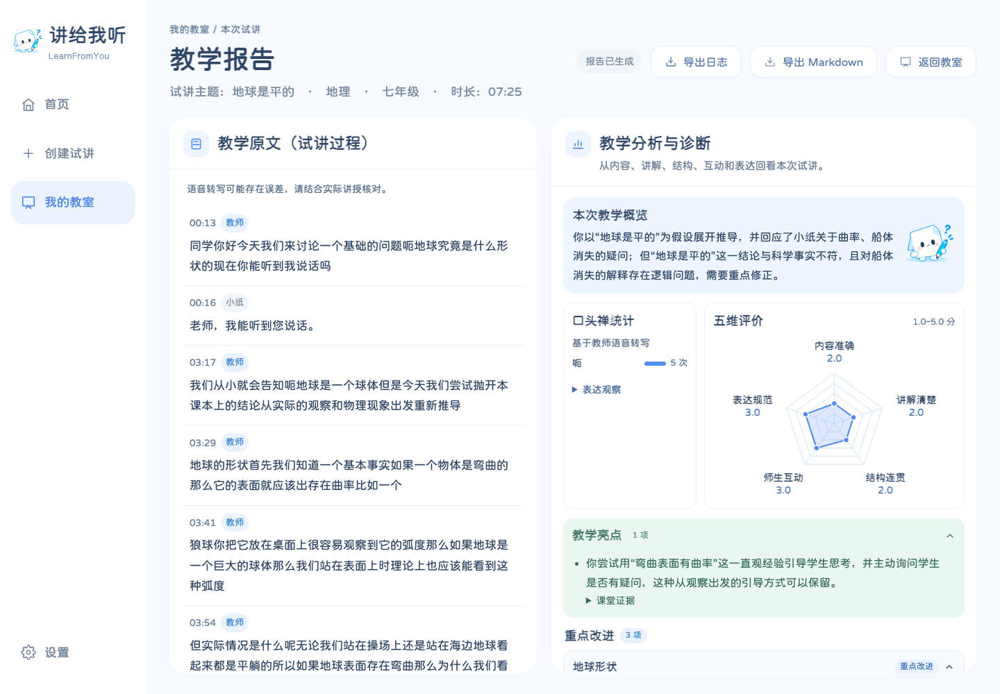
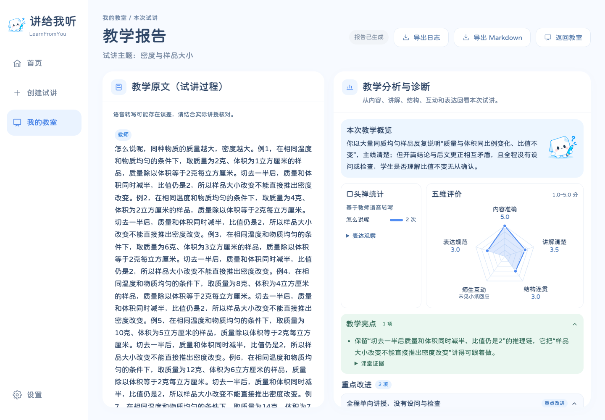

# 报告分支变基与验收说明

2026-11-21。变基和代码整合完成后，已先通知用户再执行测试。全部验收使用独立数据；真实模型只使用既有转写和合成文字，未测试音频设备或识别准确率。

## 提交与备份

| 项目 | 固定值 |
| --- | --- |
| 原分支 | `Refactor/精简状态机` |
| 变基前源提交 | `4ee87ffff77e27258a15c954daf1a90ffce27bcb` |
| 本地备份分支 | `codex/backup-before-report-rebase-20261121`，指向上述源提交 |
| 获取并固定的远端目标 | `feat/report-reflection`，`48bc818ba29dfd6885c57159cb6d3f17f8d9833a` |
| 推送前再次核对的远端源提交 | `15a1e05ae851e1972d66d5451bee6d8b53503001` |
| 变基完成提交 | `b12ce9239859c548cb2bca44a657b155499a4b7d` |
| 最终整合提交 | 包含本说明的提交；最终同步哈希另记在独立验收目录 `sync.json` |

在现有临时工作树 `codex/report-rebase-20261121` 重放了 7 个提交，前 6 个直接通过，最后一个提交有 5 处冲突。目标分支是结果分支的祖先，没有合并提交。备份分支未推送。

原工作区存在 PPT 锁文件的删除，以及用户新建的 `docs/2026-11-21-易班ppt/Untitled.md`。两者保留原状，不纳入本次修复提交；同步前后分别核对路径、状态和内容哈希。

## 冲突整合

| 文件 | 整合结果 |
| --- | --- |
| `backend/report_pipeline.py` | 保留长课、准确性核对及口头禅统计；移除原文副本和审核状态输入，分块只切最终文本 |
| `backend/report_scoring.py` | 保留原生准确性评分、其余四维证据和程序计算；删除按审核状态屏蔽评分的逻辑 |
| `backend/teaching_report.py` | 保留五维详情、长课结果和历史读取；合入逐段选文、单次空转写不清空评分、空课留空和转写提示 |
| `tests/test_report_integration.py` | 同时保留截图、评分、统计、导出、历史只读断言，改用统一文本及新空转写规则 |
| `tests/teaching_report_browser.cjs` | 同时保留准确性详情、移动布局、转写提示和调试事件验收 |

关联修复覆盖 `report_accuracy.py`、`report_calculation.py` 和 `report_contract.py`，避免只解决文件冲突后仍留下旧审核限制。未审核讲授不会被自动判为不可评价，改进项不会再因审核状态被静默删除。

## 最终行为

后端在 `review.selected_text` 统一选择历史与报告读取的文本：键盘输入直接采用原文；审核成功且文字有效时采用审核结果；关闭、失败、超时或无效结果回到原始转写。实时学生调用继续使用审核器提交的同一最终文本。

```python
if (source.get('mode') == 'text' or source.get('review_status') in
        ('reviewed', 'corrected', 'unchanged')) and isinstance(text, str) and text.strip():
    return text
return raw
```

总结、五维和口头禅使用 `text`。总结输入无 `original_text`、`raw_text`、`review_status`，模型不推测原话和审核可靠性。原始转写继续保存在日志和主动展开的详情里。报告页、Markdown 各显示一次转写误差提示。

正式课堂转写面板按来源 ID 更新同一条记录。审核期间显示“审核中”，完成后显示最终文本；识别、审核和分段事件不再形成重复默认正文。历史对话索引版本升至 5，旧索引重建，原日志与报告不被改写。

只读字段兼容保留原修复：仅在 `student`/`student_resume` 校验前移除 `question_updates[*].attempts`、`response_request_updates[*].input_revision`。原始 `llm_output.raw` 完整保存；`student_recovery/readonly_fields_ignored` 记录字段路径、模型原值、阶段和原因。未知字段、来源、revision、依赖和原子提交校验继续生效。

`asr_empty` 仅留在采集日志，不作为教学推断，也不单独清空五维。完整空课、问候和试音五项留空，显示“无可评价讲授”；有低档行为证据可以为 1.0。没有新增采集告警、连续空识别阈值。

口头禅保留语境判断：排除键盘、学生、重复上下文；允许分段只记一次，再跨段累计；只展示至少两次的前四项；超出最终文本实际出现次数的候选不采纳。

### 长课验收中补充修复

首次长课模型漏记段尾填充词，提示词已明确分段不应用“至少两次”展示门槛，并检查段尾。模型可能继续漏记，程序的次数上限校验不能证明语义分类或召回完整。

首次准确性核对把同一来源中重复的同一结论一律当作无法定位，导致整维留空。现在当这些重复引用相对更正、同知识点不同判定的位置一致时，可使用相同结论作为依据；若重复区间跨过更正或不同判定的引用位置，仍要求唯一上下文并留空。回归保留“错误→更正→再次错误”的拒绝案例，覆盖显式更正标志和同主题不同判定。

没有放松逐字、来源、角色和问答时序校验。学科依据仍展示在核对详情，正文及练习使用教师可采用的具体做法。已更正的知识错误不再作为最终准确性改进项。

## 验收结果

| 验收 | 结果 |
| --- | --- |
| 首轮定向 Python | 273 通过 |
| 最终完整 Python | 702 通过、11 跳过；1 条既有 TestClient 弃用提示 |
| 最后补充的评分回归 | 57 通过，包含重复引文与更正位置 |
| 前端脚本 | `formal_records.mjs`、`formal_recovery.mjs`、`formal_report.mjs` 通过 |
| 原有报告浏览器 | 桌面/移动、五维、统计、证据、Markdown、V2、`/debug` 通过 |
| 正式课堂记录浏览器 | 审核中→审核正文、原文展开、单条更新、兼容事件、草稿、滚动、导出通过 |
| 真实报告只读浏览器 | 地平说/短课/长课全部通过；`/`、`/debug`、报告直接访问与刷新、证据跳转、移动布局、导出通过；0 次 POST、0 页面脚本错误 |
| 原始 t9/t11 离线回放 | 14 项检查通过，无真实请求 |

回放证明：t9 原始 revision 和依赖错误仍被拒绝，失败不改变状态；修正后保留 `k6→k5`。t11 原始只读字段回显一次通过且保留原输出和兼容事件；候选生成不增加提问次数，实际发言后加一次。现有回归还覆盖候选取消和过期复核不能覆盖新状态。

### 真实模型台账

目的地 `https://api.deepseek.com/chat/completions`，`deepseek-chat`。本轮共 **16 次请求、16 次响应**，包含失败和内部修正，已停止调用。用户另行授权把剩余两次全局额度调给长课，因此长课累计 10 次，整批仍不超过 16 次。

| 案例 | 累计请求 | 最终结果 |
| --- | ---: | --- |
| 地平说报告 | 2 | 两轮均一次生成；准确性 2.0，提出地球形状和船体消失解释的具体改进 |
| t9 学生轮次 | 1 | 一次通过，保留冲突依赖与理解障碍 |
| t11 学生轮次 | 1 | 一次通过，实际提问计数正确 |
| 短语音文本课堂 | 2 | 两轮均一次生成；采用审核文本，原文“幽灵词”不泄漏，填充词累计 2 次 |
| 长课报告 | 10 | 3 个分段；首次有语义验收失败，复测最终成功，准确性 5.0、识别后文更正，填充词累计 2 次 |

长课初次材料含“先暂说……后面检验”，模型视作假设，不能据此验证真实错误被纠正。第二版改为先直接断言、最后明确更正；两版原始请求和报告均保留。最终内容约 27,600 字符，三块分析。

请求 #14 与 #15 因概览“演示”没有引用相应操作证据而被拦下；#16 接收内部修正反馈后通过。三个成功分段在最后重试时直接复用，没有再请求分段。不能把最终成功解读为报告从此零重试。

本轮实际用量：输入 121,268 tokens（缓存命中 68,864、未命中 52,404），输出 19,030，总计 140,298。精确逐请求阶段、尝试、耗时、用量和校验错误见 [请求台账.json](请求台账.json)。未查询服务商账单，不把 token 总量当作精确费用。

## 报告对照

| 项目 | 修复前 | 本轮最终 |
| --- | --- | --- |
| 地平说建议 | 因“语音转写未经确认”回避判断，无具体改进 | 直接引用地球形状和船身/桅杆解释，给出球面遮挡的正确依据与重讲做法 |
| 五维 | 全部留空，理由为采集记录不完整 | 内容准确 2.0、讲解清楚 2.0、结构连贯 2.0、师生互动 3.0、表达规范 3.0 |
| 地平说口头禅 | 旧规则和旧缓存 | 最终语音文本中“呃”5 次；保留语境筛选与次数上限 |
| 长课 | 首次重复引文及漏记导致未满足验收 | 准确性 5.0，后文更正保留，“怎么说呢”跨段 2 次；互动因缺少模型提供的行为依据留空 |

完整对照：[修复前报告](地平说-修复前.md)、[修复后报告](地平说-修复后.md)、[短课报告](短课-验收报告.md)、[长课报告](长课-验收报告.md)。





## 原始证据与运行

独立记录在工作树 `logs/report-rebase-20261121/`，包括：`before/` 原始日志和旧报告、`before-sha256.json`、全部测试输出、`replay/` 关键轮次回放、`live-first-attempt/` 首轮失败快照、`live/model-events.jsonl` 全部 16 次请求和原始输出、`live/logs/` 阶段缓存、`screenshots/` 完整截图。原始日志不提交 Git；本目录仅提交汇总、报告和精选截图。

原课堂日志 SHA-256：`66f81f083e0ed6b160676b344030f07f39171a3451f8055abb586e4380267e14`。其他修复前文件哈希见 [修复前文件哈希.json](修复前文件哈希.json)。

复现入口：`tests/live_report_rebase.py`（有费用，累计上限控制）、`tests/live_earth_report_repair.py`（默认离线）、`tests/report_rebase_browser.cjs`（只读浏览器）。所有新脚本有中文用途说明。

## 风险与限制

转写错误仍会影响评价，模型对独立解释、学科结论与填充用法也会波动。有限真实测试验证了指定故障场景，不能保证所有课堂不再重试。重复结论的位置一致性只解决可观察的引文时序，不证明学科语义本身正确。

提示词、最终文本、评分 schema 和统计规则变化使当前 V3 缓存失效；读取、刷新、导出保持只读，重新生成由原有入口触发。冻结的旧提示词继续供 V2 哈希兼容读取。旧报告保留备份，地平说新缓存仅在来源哈希与当前代码核对一致后同步。

本轮未测真实麦克风、识别准确率、云端或 Windows 实课稳定性。11 个跳过项保持测试原有条件，没有伪造完成。
